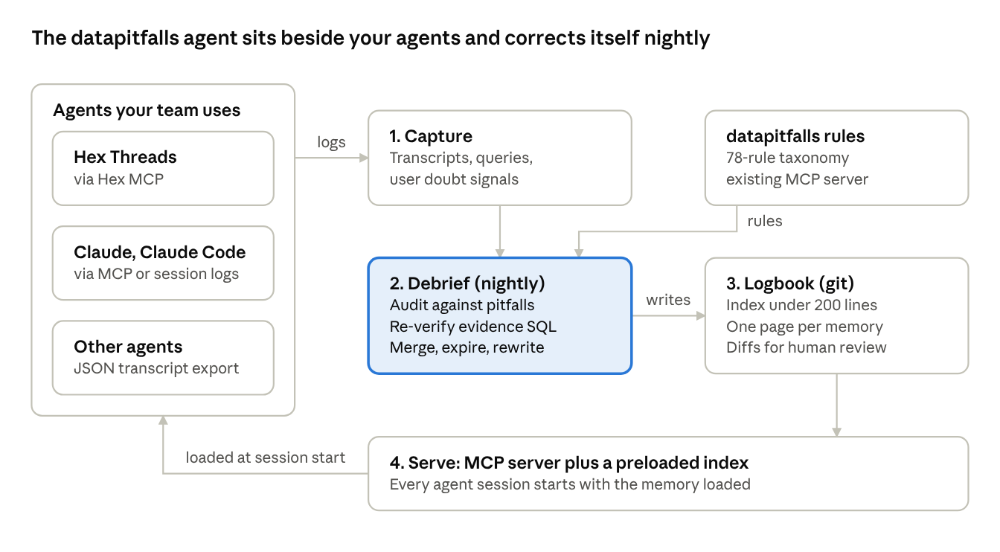

# datapitfalls agent

**The reviewer that remembers.**

AI analytics agents repeat mistakes, forget the quirks that make a dataset safe to use, and keep no record of how many cuts they tried before a "finding." The datapitfalls agent fixes that. It runs next to the agent you already use (Claude, Claude Code, Hex and others), reviews past sessions overnight against the [Avoiding Data Pitfalls](https://www.avoidingdatapitfalls.com) taxonomy, and keeps a small, human-approved memory that every new session loads.

- **Debrief**: a nightly review of recent sessions that finds pitfalls and proposes lessons
- **Logbook**: a git repo of memory (quirks, lessons, decisions), every change a reviewable diff
- **Ledger**: tracks the hypotheses and cuts tried per question, and warns before a lucky result becomes a "finding"
- **Serve**: an MCP server that hands memory to your agent at session start

Local-first, read-only, and model-neutral by design.

## Status

🚧 **Pre-release.** The spec is in [docs/PRD.md](docs/PRD.md). The method is being tested first in [datapitfalls bench](https://github.com/bjonesdataliteracy/datapitfalls-bench).

## Part of the datapitfalls family

| Project | What it does |
| --- | --- |
| [datapitfalls](https://github.com/bjonesdataliteracy/datapitfalls) | The rules: 78-rule taxonomy, CLI, MCP connector |
| [datapitfalls bench](https://github.com/bjonesdataliteracy/datapitfalls-bench) | The benchmark on changing data |
| **datapitfalls agent** | This repo: the reviewer that remembers |

## License

Code is [MIT](LICENSE). The Avoiding Data Pitfalls taxonomy the agent uses is licensed separately under CC BY-NC 4.0: free to use at work; selling it or building it into a paid product needs a license (see [LICENSE-TAXONOMY.md](https://github.com/bjonesdataliteracy/datapitfalls/blob/main/LICENSE-TAXONOMY.md)).

Based on *Avoiding Data Pitfalls* by Ben Jones (Wiley, 2019). Made by [Data Literacy](https://dataliteracy.com).
