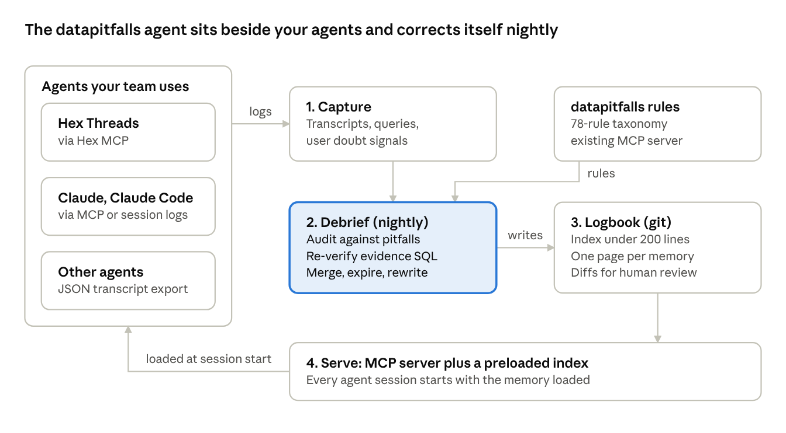

# PRD 3: datapitfalls agent

> Part of the datapitfalls PRD set. Related specs: [PRD 1: datapitfalls core](https://github.com/bjonesdataliteracy/datapitfalls/blob/main/docs/prd/PRD-1-core.md) · [PRD 2: datapitfalls bench](https://github.com/bjonesdataliteracy/datapitfalls-bench/blob/main/docs/PRD.md)



## Summary

The datapitfalls agent is an open-source reviewer that remembers. It runs next to the analytics agent a team already uses, reviews past sessions overnight against the Avoiding Data Pitfalls taxonomy, and keeps a small, human-approved memory every new session loads.

**Problem.** Analytics agents repeat mistakes across sessions, forget the quirks and decisions that make a dataset safe to use, and keep no record of how many cuts were tried before a "finding." Vendor memory features cover metric definitions inside one tool, not reasoning across tools.

### Users

| User | Situation | What they need |
| --- | --- | --- |
| Data lead | Rolled out an analytics agent; worried about confident wrong answers | Fewer repeat errors; a reviewable record of what the agent "knows" |
| Analyst using Claude or Claude Code | Does analysis with an agent daily | Quirks and past lessons loaded automatically; warnings before overclaiming |
| Consultant or reviewer | Audits a team's AI analytics output | A tool to review the last 30 days of agent sessions and leave a memory behind |

### Key use cases

1. A new session starts; the agent loads the index and knows that March 2025 sessions doubled because of a tracking change.
2. Overnight, Debrief reviews yesterday's sessions, finds an unweighted average of rates, and proposes a lesson as a pull request.
3. An analyst's agent is about to report a "significant" segment; the Ledger notes it is the 14th cut tried on that question.
4. A quirk's half-life expires; Debrief re-runs its evidence query read-only and marks it confirmed or changed.
5. A reviewer points the agent at a team's transcript export and delivers a findings report plus a starter Logbook.

**Goals.** Measurably fewer repeat pitfalls on real transcripts; memory proposals humans accept at least 60% of the time; install-to-first-Debrief in under 10 minutes.

**Non-goals.** Answering business questions; real-time blocking of agent answers (v1 is offline plus load-time); editing semantic layers; any write access to data.

## Functional requirements

Five modules, each a folder in the package: Capture, Debrief, Logbook, Ledger and Serve. v0.1 ships every P0.

| ID | Module | Requirement | Priority |
| --- | --- | --- | --- |
| A1 | Capture | Adapters: Claude Code session logs and generic JSON (P0); Claude via an MCP `log_session` tool (P0); Hex threads via the Hex MCP (P1) | P0/P1 |
| A2 | Capture | Detect doubt signals: user corrections, "are you sure?", reruns, abandoned answers | P0 |
| A3 | Capture | Redact secrets and common PII patterns before anything is stored | P0 |
| A4 | Capture | Store transcripts locally in SQLite by default; Postgres optional | P0 |
| A5 | Debrief | Select sessions since the last run, weighted by doubt signals, errors and new trend claims | P0 |
| A6 | Debrief | Review selected sessions with core `scan --transcript` (Core C5) | P0 |
| A7 | Debrief | Draft memory records (lesson, quirk, decision) with `pitfall_ids` and evidence links | P0 |
| A8 | Debrief | Merge duplicates, expire stale records, keep the index under its line budget | P0 |
| A9 | Debrief | Output changes as a git branch and pull request, or a local diff when no remote exists | P0 |
| A10 | Debrief | Write a short Debrief report: sessions reviewed, findings, proposed changes, cost | P0 |
| A11 | Debrief | Enforce a per-run cost cap and a dry-run mode | P0 |
| A12 | Debrief | Re-verify expired memories by running their evidence query on a read-only connection | P1 |
| A13 | Logbook | Repo layout: `INDEX.md` (about 200 lines max) plus one markdown page per record with schema frontmatter | P0 |
| A14 | Logbook | Human-written records (`source: human`) are never rewritten by Debrief, only flagged | P0 |
| A15 | Ledger | Record each hypothesis and cut per question family via `log_hypothesis` | P1 |
| A16 | Ledger | Warn when a family passes a threshold of cuts, citing `multiple-comparisons` | P1 |
| A17 | Serve | MCP tools for agents (see Interfaces), served alongside the core rules (Core C8) | P0 |
| A18 | Serve | Generate a preload snippet for `CLAUDE.md`, Hex guides or a system prompt | P0 |

## Interfaces

One CLI, one config file, one memory repo and a handful of MCP tools; the package is `@datapitfalls/agent` with the binary `datapitfalls-agent`.

### CLI

```bash
npx @datapitfalls/agent init            # create config + Logbook repo, print preload snippet
datapitfalls-agent capture --from claude-code ~/.claude/projects/acme
datapitfalls-agent debrief --since 24h --budget 2.00 --dry-run
datapitfalls-agent debrief --since 24h --open-pr
datapitfalls-agent verify --expired       # re-run evidence queries (read-only)
datapitfalls-agent serve                  # MCP server: core rules + memory tools
datapitfalls-agent audit transcripts/ --report audit.md   # reviewer mode
```

### Config (`datapitfalls-agent.yaml`)

```yaml
logbook: ./logbook            # git repo for memory
sources:
  - type: claude-code
    path: ~/.claude/projects/acme
  - type: generic
    path: ./exports/*.json
debrief:
  schedule: "0 2 * * *"       # nightly
  budget_usd: 2.00
  index_max_lines: 200
verify:
  connection: env:READONLY_WAREHOUSE_URL
redact: [emails, api_keys, card_numbers]
```

### Logbook layout

```text
logbook/
  INDEX.md                 # preloaded every session, about 200 lines max
  quirks/2025-03-tracking-migration.md
  lessons/normalize-regions-by-population.md
  decisions/exclude-pilot-accounts.md
  ledger/churn-by-segment.md
  debriefs/2026-12-01.md   # nightly reports
```

### MCP tools

| Tool | What it does | Priority |
| --- | --- | --- |
| `get_memory_index` | Returns `INDEX.md` for session start | P0 |
| `search_memory` | Finds records by text, table, metric or rule ID | P0 |
| `get_memory` | Returns one record with its evidence | P0 |
| `propose_memory` | Lets the working agent suggest a record; lands as a pending proposal for Debrief | P0 |
| `flag_quirk` | Shortcut to propose a data quirk with evidence | P0 |
| `log_session` | Lets MCP-only clients send their transcript to Capture | P0 |
| `log_hypothesis` | Adds a cut or test to the Ledger and returns the family's running count | P1 |

The existing core tools (`get_checklist`, `get_pitfall`, `list_pitfalls`, `search_pitfalls`) are served from the same endpoint.

## Non-functional requirements, milestones and metrics

Trust is the product: privacy, read-only access and predictable cost matter more than features in v0.1.

| Area | Requirement |
| --- | --- |
| Privacy | Everything local by default; no telemetry without opt-in; redaction before storage |
| Security | Verification uses a separate read-only credential; the agent never holds write access to data |
| Cost | Hard per-run budget; Debrief over 50 sessions should cost a few dollars at default settings (confirm with bench numbers) |
| Reliability | A failed Debrief leaves the Logbook untouched; every change is a reviewable diff |
| Portability | Node 18+, macOS, Linux and Windows; no cloud services required |
| Model | Claude by default through the core engine; model id configurable |
| Licensing | Agent code MIT; taxonomy used under CC BY-NC terms, free for use at work; no resale without a license |

| Release | Scope | Target |
| --- | --- | --- |
| v0.1 alpha | A1 (Claude Code, generic), A2 to A11, A13, A14, A17, A18; demo on bench data | Feb 2027 |
| v0.2 | Hex adapter, Ledger (A15, A16), `audit` reviewer mode | Mar 2027 |
| v0.3 | Re-verification (A12), half-life tuning from early-user data | May 2027 |
| v1.0 | Stable schemas and MCP tools; published case studies | Jul 2027 |

**Success metrics:** 10 outside teams running Debrief on their own data; 60%+ of memory proposals accepted; repeat-pitfall rate down at least 30% on real transcripts; median index under 150 lines.

**Open questions:**

- [ ] Pull requests require GitHub; is a plain local review queue enough for v0.1?
- [ ] Should `propose_memory` from the working agent be allowed at all, or should only Debrief write?
- [ ] How does the agent read Hex threads at scale through the Hex MCP, and what are the rate limits?
- [ ] What is the right default half-life per memory kind before real usage data exists?
